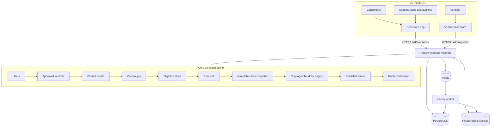

# Target Architecture

Asset-Draw is a modular monolith: consumer and vendor interfaces use the same React application and FastAPI API,
with PostgreSQL as the transactional source of truth. Redis brokers Celery jobs. Private object storage holds
vendor-submitted prize and verification assets. The draw engine remains isolated and its output is independently
verifiable; frontend animations only present backend-published states and results.

Campaign prize images are uploaded by vendors and served from private storage through validated, scoped access.
The database owns campaign and draw state; the browser never selects a winner or invents a draw state.

## Module map (`backend/app/`)
| Package | Status | Purpose |
|---|---|---|
| `core` | done | settings, DB session, Redis, request-ID middleware, health |
| `auth`, `users` | Phase 2 | registration/login, JWT, RBAC |
| `vendors`, `assets`, `campaigns` | Phase 3 | onboarding, asset verification, campaign state machine |
| `entries` | Phase 4 | eligibility, capacity, immutable entries |
| `payments` | Phase 5 | `PaymentProvider` interface, Chapa adapter, webhooks |
| `draws`, `winners` | Phase 6 | isolated Draw Engine |
| `verification` | Phase 7 | public verification API + package |
| `notifications`, `audit`, `admin` | as needed | messaging, append-only audit, admin APIs |

## Phase status (verified 2026-10-01)
| Phase | Deliverable | State |
|---|---|---|
| 0 | Repo, Docker, skeletons, health, CI | Existing scaffold present; full Compose startup still needs environment validation |
| 1 | Database + migrations | Complete: 34 ORM tables, clean-install Alembic revisions, PostgreSQL T1–T9 triggers, least-privilege group roles, invariant tests, ER diagram. Backend tests and Ruff pass |
| 6 (engine only) | Pure draw engine, vectors, standalone verifiers | Complete and frozen: `backend/app/draws/engine.py`, `tests/vectors/draw_v1.json`, and `verifier/`. Draw orchestration remains future work |
| 2 | Authentication + RBAC | Next: `agent/prompts/02_AUTH_RBAC.md` |
| 3–5, 7–10 | Vendor/assets/campaigns, entries, payments, orchestration, public verification, frontend and deployment | Not started or partial; see `agent/prompts/` |
